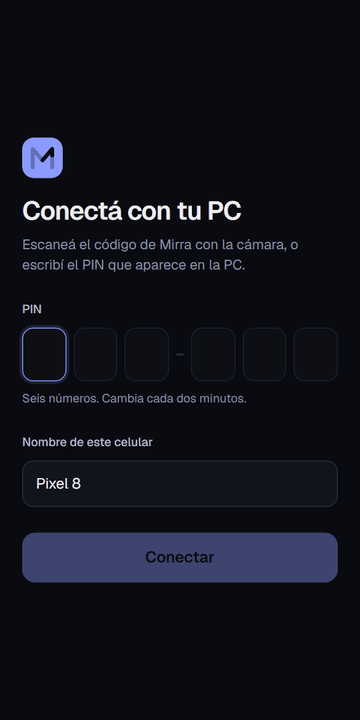
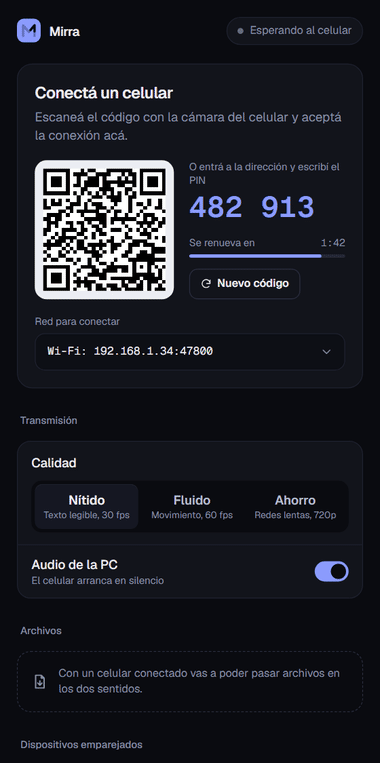
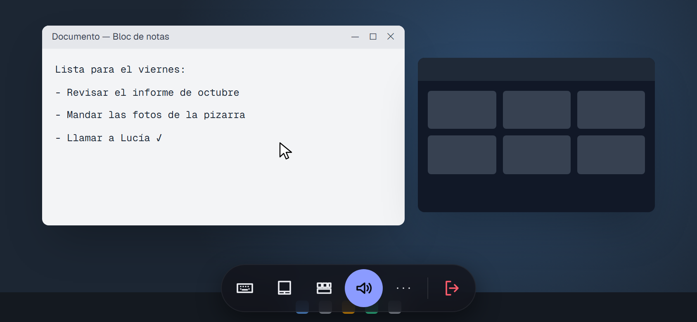
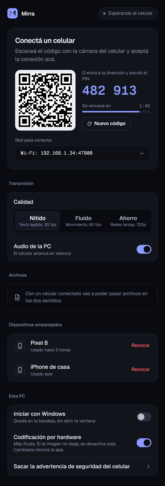
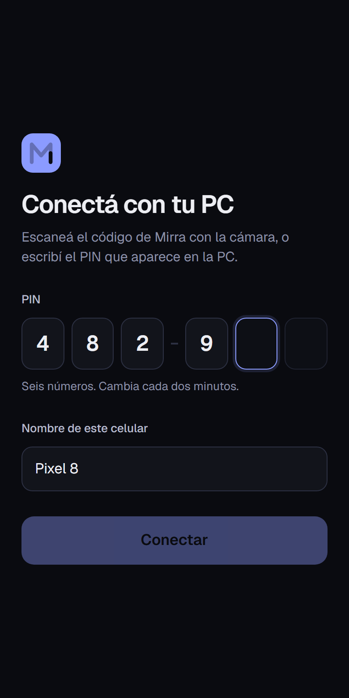
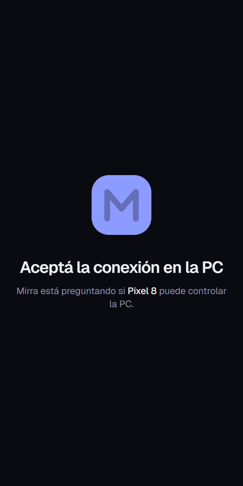
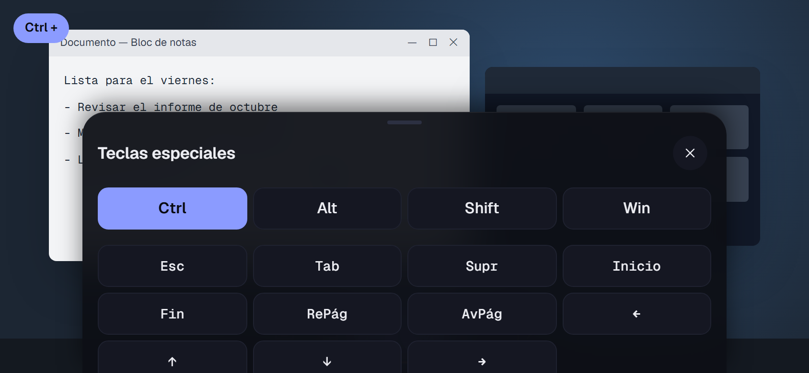
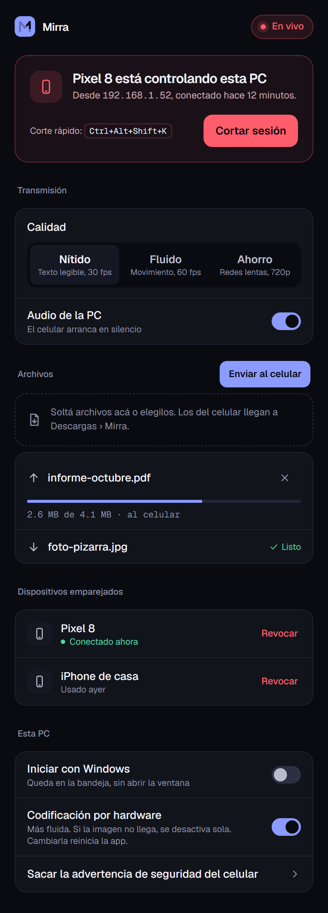
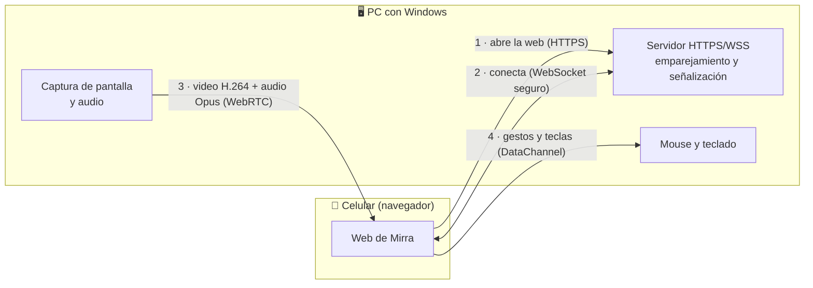

<div align="center">


# Mirra

**Tu PC, en la palma de tu mano.**
Mirá y controlá tu PC con Windows desde el navegador del celular. Sin instalar nada en el celular, sin cuentas y sin nube.

[](https://github.com/kilorito2/mirra-remote/releases/latest)


</div>

<br>

<table>
<tr>
<td width="50%" align="center"><br><sub><b>En el celular:</b> escribís el PIN (o escaneás el QR) y aceptás en la PC.</sub></td>
<td width="50%" align="center"><br><sub><b>En la PC:</b> ves quién está conectado y lo cortás cuando quieras.</sub></td>
</tr>
</table>

<div align="center">

<br><sub>Así se ve tu PC en el celular (horizontal). La barra de abajo tiene teclado, modo de mouse, teclas especiales, audio, más opciones y salir.</sub>
</div>

---

## ✦ Qué podés hacer

<table>
<tr>
<td width="50%" valign="top">
&nbsp;<b>Conectar en segundos</b><br>
&nbsp;Escaneás un QR o escribís un PIN de 6 números. La próxima vez conecta sola.
</td>
<td width="50%" valign="top">
&nbsp;<b>Pantalla fluida</b><br>
&nbsp;Video H.264 por hardware de hasta 1080p a 60 fps, con calidad Nítido, Fluido o Ahorro.
</td>
</tr>
<tr>
<td valign="top">
&nbsp;<b>Mouse con el dedo</b><br>
&nbsp;Modo trackpad o táctil directo: clic, doble clic, clic derecho, arrastrar, scroll y zoom.
</td>
<td valign="top">
&nbsp;<b>Teclado completo</b><br>
&nbsp;El teclado del celular (ñ, tildes, @, €) más Esc, F1–F12, flechas, Ctrl, Alt, Win y combinaciones.
</td>
</tr>
<tr>
<td valign="top">
&nbsp;<b>Audio de la PC</b><br>
&nbsp;Escuchá lo que suena en la PC. El celular arranca en silencio y lo activás con un toque.
</td>
<td valign="top">
&nbsp;<b>Portapapeles</b><br>
&nbsp;Pasá texto de la PC al celular y del celular a la PC.
</td>
</tr>
<tr>
<td valign="top">
&nbsp;<b>Archivos en los dos sentidos</b><br>
&nbsp;Soltá un archivo en la ventana para mandarlo al celular. Lo que mandes desde el celular llega a <i>Descargas › Mirra</i>.
</td>
<td valign="top">
&nbsp;<b>Varios monitores</b><br>
&nbsp;Elegí qué pantalla ver sin cortar la sesión.
</td>
</tr>
<tr>
<td valign="top">
&nbsp;<b>Reconexión sola</b><br>
&nbsp;Si se corta el Wi-Fi, vuelve sola. Y nunca queda una tecla apretada en la PC.
</td>
<td valign="top">
&nbsp;<b>Privado y seguro</b><br>
&nbsp;Todo viaja directo por tu red y cifrado. Nadie de afuera puede entrar.
</td>
</tr>
</table>

---

## ⬇ Instalar

1. Descargá **`Mirra Setup.exe`** desde [Releases](https://github.com/kilorito2/mirra-remote/releases/latest) y ejecutalo.
   > Windows SmartScreen puede avisar que la app no es conocida (no está firmada). Tocá **Más información › Ejecutar de todas formas**.
2. Abrí Mirra. La primera vez Windows pide permiso de red: marcá **solo _Redes privadas_**. Así el celular te encuentra en casa y nadie te ve en un Wi-Fi público.
3. Listo. Mirra queda en la bandeja del sistema (al lado del reloj), con este ícono: 

---

## ➜ Conectar el celular

<table>
<tr>
<td width="56%" valign="top">

**1. Abrí Mirra en la PC.** Vas a ver un código QR, un PIN de 6 números y la red por la que se conecta.

**2. Escaneá el QR con la cámara del celular.** El celular tiene que estar en el **mismo Wi-Fi** que la PC (o en tu Tailscale). Si no podés escanear, abrí la dirección que muestra la PC y escribí el PIN.

**3. Aceptá el aviso del certificado.** El navegador dice que la conexión "no es privada": es normal, porque el certificado es de tu propia PC y no de una empresa. Tocá **Configuración avanzada › Continuar**.
> Para que el aviso no vuelva a aparecer, mirá [Sacar la advertencia de seguridad](#-sacar-la-advertencia-de-seguridad).

**4. Aceptá la conexión en la PC.** Aparece un aviso con el nombre del celular: tocá **Permitir**.

**5. ¡Listo!** La próxima vez abrís la web en el celular y conecta sola, sin volver a aprobar.

</td>
<td width="44%" valign="top" align="center">

<br><sub>La ventana de Mirra en la PC.</sub>
</td>
</tr>
</table>

<table>
<tr>
<td align="center"><br><sub>Escribís el PIN…</sub></td>
<td align="center"><br><sub>…y esperás el OK de la PC.</sub></td>
</tr>
</table>

> **Tip:** en Android, Chrome ofrece _Agregar a la pantalla principal_. En iPhone, **Compartir › Agregar a inicio**. Así Mirra se abre a pantalla completa, como una app.

---

## ✋ Usarlo desde el celular

Poné el celular **horizontal**. La barra flotante de abajo se esconde sola a los 4 segundos; tocá la rayita de abajo para que vuelva.

| Botón | Qué hace |
|---|---|
|  **Teclado** | Abre el teclado del celular y escribe en la PC |
|  **Modo** | Cambia entre **trackpad** (movés un cursor como en una notebook) y **táctil directo** (tocás donde querés hacer clic) |
|  **Teclas especiales** | Esc, Tab, flechas, F1–F12, Ctrl/Alt/Shift/Win y atajos como Alt+Tab o Ctrl+C |
|  **Audio** | Activa o silencia el sonido de la PC |
| **⋯ Más opciones** | Pantalla, calidad, estadísticas, pantalla completa, portapapeles y archivos |
| **Salir** | Termina la sesión |

### Gestos

| Gesto | Modo trackpad | Modo táctil directo |
|---|---|---|
| Tocar con 1 dedo | Clic (dos toques: doble clic) | Clic donde tocaste (dos toques: doble clic) |
| Tocar con 2 dedos | Clic derecho | Clic derecho |
| Arrastrar 1 dedo | Mover el cursor | Arrastrar (mantiene el botón apretado) |
| Arrastrar 2 dedos | Scroll | Scroll |
| Pellizcar | Zoom en el celular (no en la PC) | Zoom en el celular |
| Mantener apretado | Agarrar: después arrastrás para seleccionar o mover | Clic derecho |

<div align="center">

<br><sub><b>Teclas especiales:</b> los modificadores (Ctrl, Alt, Shift, Win) quedan "pegados" hasta la próxima tecla. Tocás <b>Ctrl</b> y después <b>C</b> para copiar.</sub>
</div>

---

## 🖥 En la PC

<table>
<tr>
<td width="44%" align="center"></td>
<td width="56%" valign="top">

Mientras alguien controla la PC, **siempre lo vas a saber**:

- La ventana muestra **"En vivo"** y qué celular está conectado.
- El ícono de la bandeja se pone rojo: 
- Aparece un **borde rojo** alrededor de la pantalla (no sale en el video).

**Para cortar al instante:** botón **Cortar sesión**, menú de la bandeja, o <kbd>Ctrl</kbd>+<kbd>Alt</kbd>+<kbd>Shift</kbd>+<kbd>K</kbd> desde cualquier lugar.

**Ajustes:**
- **Calidad:** _Nítido_ (texto legible), _Fluido_ (60 fps, para videos y juegos) o _Ahorro_ (redes lentas).
- **Audio de la PC:** mandar o no el sonido.
- **Dispositivos emparejados:** mirá cuáles hay y **revocá** el que ya no quieras.
- **Iniciar con Windows:** queda en la bandeja sin abrir la ventana.

</td>
</tr>
</table>

---

## 🔒 Seguridad

- **Solo tu red.** Mirra acepta conexiones únicamente de la red local o de Tailscale. Desde internet no se puede entrar.
- **Todo cifrado.** HTTPS con un certificado propio de tu PC y WebRTC cifrado de punta a punta.
- **Vos aprobás cada celular nuevo**, en la PC. Después se reconecta con una clave que nunca vuelve a viajar por la red.
- **Uno a la vez.** Solo un celular puede controlar la PC por vez.
- **Siempre visible:** bandeja roja, borde rojo y atajo para cortar.
- **Nada queda apretado.** Si se corta la conexión, la PC suelta todas las teclas y botones.

Detalles técnicos en [docs/SECURITY.md](docs/SECURITY.md).

### 🔐 Sacar la advertencia de seguridad

Para que el navegador no muestre el aviso del certificado, instalá en el celular la autoridad de certificación (CA) de tu PC. En Mirra, abrí **Esta PC › Sacar la advertencia de seguridad del celular** y seguí los pasos:

- **iPhone:** abrí `https://<IP-de-la-PC>:<puerto>/ca.crt` › Ajustes › General › VPN y gestión de dispositivos › Instalar. Después Ajustes › General › Información › Confianza de certificados, y activalo.
- **Android:** descargá el mismo archivo › Ajustes › Seguridad › Más ajustes › Instalar certificados › Certificado de CA.

> Antes de instalarlo, compará la huella SHA-256 que muestra el celular con la que aparece en Mirra. Si no coinciden, **no lo instales**.

---

## 🛠 Si algo no anda

<details>
<summary><b>El celular no encuentra la PC</b></summary>

- Fijate que el celular y la PC estén en el **mismo Wi-Fi** (o los dos en Tailscale).
- Si cuando Windows pidió permiso marcaste "Redes públicas" o lo cancelaste, habilitá Mirra en **Firewall de Windows › Permitir una aplicación › Mirra (Privada)**.
- En la ventana de Mirra probá otra red en el selector (Wi-Fi, Ethernet, Tailscale).
- Algunos routers de invitados aíslan los dispositivos entre sí: usá la red principal.
</details>

<details>
<summary><b>Se ve, pero no se escucha el audio</b></summary>

- Tocá el botón del parlante en el celular (arranca en silencio).
- Revisá que **Audio de la PC** esté activado en Mirra.
- Mirra captura la **salida de audio predeterminada de Windows**. Si usás un mezclador como **SteelSeries Sonar**, Voicemeeter o similar, la app que querés escuchar tiene que sonar por esa salida. Por ejemplo, en Sonar mové el navegador o el juego al canal que Windows tiene como predeterminado.
- En **Más opciones › Estadísticas**, la fila **Audio** muestra si llega sonido: si el nivel queda en 0 %, la PC está capturando silencio.
</details>

<details>
<summary><b>La imagen se traba o va lenta</b></summary>

- Elegí **Ahorro** en la calidad.
- Usá Wi-Fi de 5 GHz y acercate al router.
- Si la imagen no llega, desactivá **Codificación por hardware** en Mirra (se reinicia la app).
</details>

<details>
<summary><b>No puedo controlar una ventana de administrador o la pantalla de bloqueo</b></summary>

Windows no deja que una aplicación común maneje ventanas elevadas (UAC), la pantalla de inicio de sesión ni Ctrl+Alt+Supr. Para eso hace falta un servicio de sistema, que Mirra todavía no tiene.
</details>

---

## 🧩 Cómo funciona



La PC sirve la web, el celular la abre y, una vez aprobado, los dos arman una conexión **WebRTC directa** por tu red: la pantalla y el sonido van de la PC al celular, y los toques y las teclas vuelven por un canal de datos. No pasa por ningún servidor externo.

---

## 👩‍💻 Desarrollo

Requisitos: **Node 22+** y **Windows 10/11**.

```bash
npm install
npm run dev        # la app en modo desarrollo
npm run check      # typecheck + lint + tests unitarios
npm run dist       # instalador en release/
```

<details>
<summary><b>Todos los comandos</b></summary>

| Comando | Qué hace |
|---|---|
| `npm install` | Dependencias (robotjs trae binario N-API; no hacen falta Build Tools) |
| `npm run dev` | App en modo desarrollo |
| `npm run check` | Typecheck + lint + tests unitarios |
| `npm test` | Vitest (unit + componentes) |
| `npm run test:e2e` | Playwright: app Electron real + Chromium móvil + WebKit (FakeInjector) |
| `npm run test:e2e:real` | Clic y tipeo con el injector real en una ventana de prueba (**mueve el mouse**) |
| `npm run android:setup` | Instala JDK portable, cmdline-tools, imagen Android 14 y el AVD `remote-test` (sin admin) |
| `npm run test:android` | Suite con el emulador (**mueve el mouse**). `KR_WIPE=1` borra los datos del AVD si quedó trabado |
| `npm run dist` | Build de producción, verifica que no haya modo test y genera el instalador NSIS en `release/` |

Variables solo para tests (no existen en el build de producción, ADR-0008): `REMOTE_TEST_MODE=1`, `KR_INJECTOR=fake`,
`KR_AUTO_APPROVE=1`, `KR_PORT`, `KR_USER_DATA`, `KR_HW_ENCODE=0|1`.
</details>

<details>
<summary><b>Estructura del proyecto</b></summary>

```
src/main/       server HTTPS/WSS, auth, sesión, InputController, archivos, tray, overlay, IPC, ports/ y adapters/
src/preload/    ui.ts (ventana principal) y host.ts (renderer host), con contextBridge
src/renderer/   UI de la PC + host/HostPeer.ts (captura y RTCPeerConnection)
src/shared/     protocolo (zod), coordenadas, constantes, tema y marca
client/         web del celular (Vite + React), servida por la PC
tests/          e2e/ (Playwright desktop), android/ (emulador), support/
docs/           SPEC, ARCHITECTURE, PROTOCOL, SECURITY, TESTING-MANUAL, PROGRESS, adr/
```
</details>

**Stack:** Electron · React · TypeScript · Tailwind CSS · WebRTC · zod · Vitest · Playwright

Documentación técnica: [Arquitectura](docs/ARCHITECTURE.md) · [Decisiones (ADR)](docs/adr/) · [Protocolo](docs/PROTOCOL.md) · [Seguridad](docs/SECURITY.md) · [Prueba manual](docs/TESTING-MANUAL.md)

> Mirra se llamaba _Kilorito Remote_. Algunos documentos técnicos, identificadores internos y la carpeta de datos (`%APPDATA%\Kilorito Remote`) conservan ese nombre para no perder los emparejamientos al actualizar.

---

## Límites conocidos

- No controla el escritorio seguro (UAC, pantalla de inicio de sesión, Ctrl+Alt+Supr) ni ventanas elevadas.
- Solo red local o Tailscale (no hay relay por internet). Un celular a la vez.
- El contenido con DRM (Netflix, etc.) se ve negro.
- El audio sale de la salida predeterminada de Windows (ver [Si algo no anda](#-si-algo-no-anda)).

<div align="center">
<br>

<br><sub>Hecho con cariño para manejar la PC desde el sillón.</sub>
</div>
