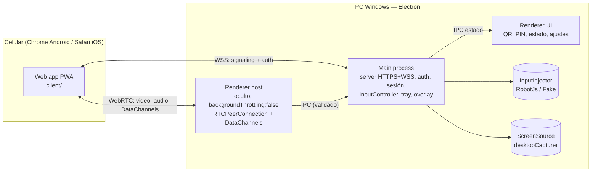
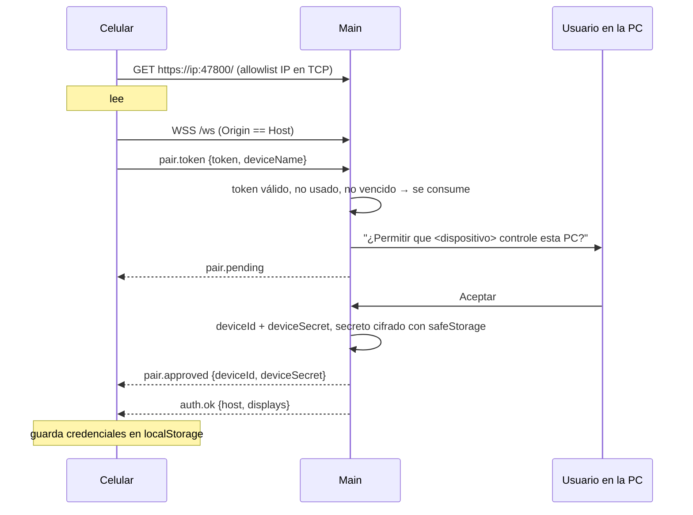
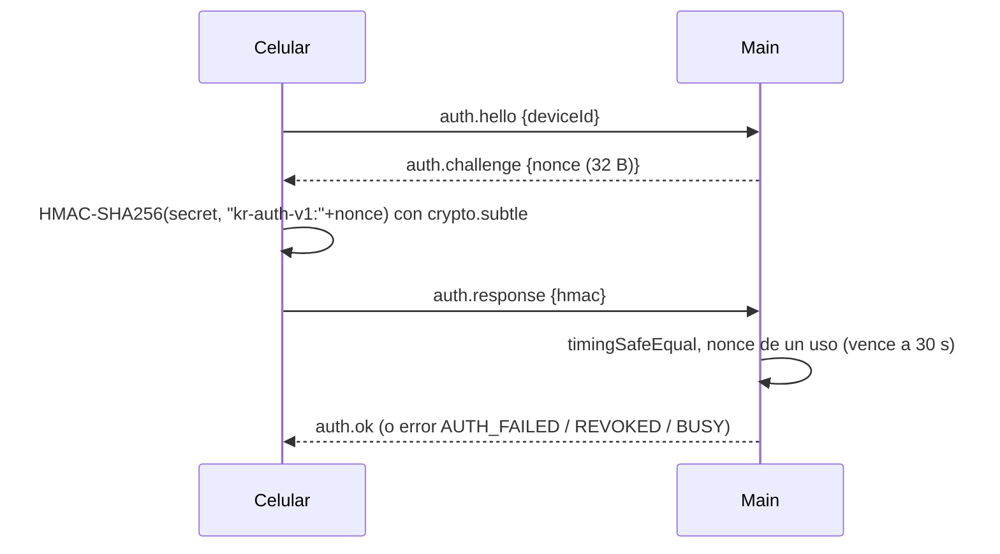
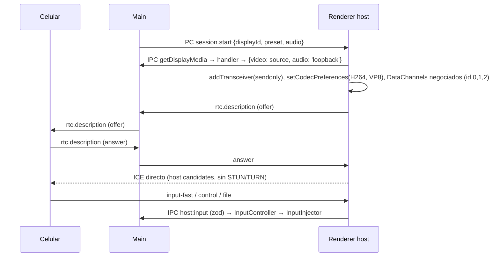
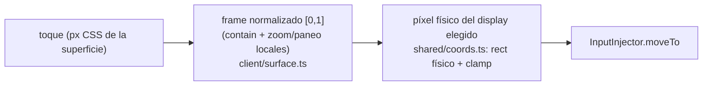

# Arquitectura

## Vista general



## Responsabilidades

| Proceso | Hace | No hace |
|---|---|---|
| **Main** | ciclo de vida, tray, server HTTPS/WSS, allowlist IP, certificados, pairing/auth, devices, `setDisplayMediaRequestHandler`, `InputController` (rate limit, watchdog, releaseAll), overlay, atajo global, archivos en disco, portapapeles | WebRTC |
| **Renderer host** | `getDisplayMedia()`, RTCPeerConnection (ofertante), codecs, presets, `replaceTrack`, DataChannels, ICE restart, stats; reenvía input validado a main | tocar disco, inyectar input |
| **Renderer UI** | mostrar estado, QR/PIN, dispositivos, ajustes, enviar archivos (drag&drop) | lógica de seguridad |
| **Client (celular)** | pairing/auth, reconocedor de gestos, teclado, barra de teclas, zoom local, portapapeles, archivos, stats overlay, Wake Lock | — |
| **shared/** | `protocol.ts` (schemas zod), `coords.ts`, `constants.ts`, helpers puros (rate limit, base64url) | dependencias de Node o DOM |

## Arquitectura hexagonal (ADR-0005)

```mermaid
flowchart TB
  subgraph Core["Núcleo (main/session, main/auth)"]
    IC[InputController]
    SM[SessionManager]
  end
  subgraph Ports
    P1[[InputInjector]]
    P2[[ScreenSource]]
  end
  subgraph Adapters
    A1[RobotJsInjector]
    A2[FakeInjector — tests]
    A3[ElectronScreenSource]
    A4[(futuro) NativeServiceInjector — Rust/SYSTEM]
  end
  IC --> P1
  SM --> P2
  A1 -.implementa.-> P1
  A2 -.implementa.-> P1
  A4 -.implementa.-> P1
  A3 -.implementa.-> P2
```

```ts
// src/main/ports/InputInjector.ts
export interface InputInjector {
  moveTo(p: ScreenPoint): Promise<void>;             // píxeles físicos
  button(b: MouseButton, action: 'down' | 'up'): Promise<void>;
  scroll(dx: number, dy: number): Promise<void>;      // unidades WHEEL_DELTA (120 = 1 muesca)
  key(k: KeyName, action: 'down' | 'up'): Promise<void>;
  typeText(text: string): Promise<void>;              // unicode, sin dejar teclas apretadas
  cursorPosition(): Promise<ScreenPoint>;
  releaseAll(): Promise<void>;                        // idempotente
}

// src/main/ports/ScreenSource.ts
export interface ScreenSource {
  listDisplays(): DisplayInfo[];                      // id, label, rect físico, scaleFactor, primary
  captureSourceFor(displayId: string): Promise<CaptureSource>; // id de desktopCapturer
  onDisplaysChanged(cb: () => void): () => void;
}
```

`InputController` (núcleo) es el único que habla con `InputInjector`: lleva el registro de teclas/botones apretados,
aplica clamp, rate limit (token bucket 500/s, ráfaga 100) y el watchdog de heartbeat (3 s ⇒ `releaseAll`).

## Flujos

### Emparejamiento por QR



### Reconexión (challenge-response)



### Sesión WebRTC



### Corte de sesión
Cualquiera de: Ctrl+Alt+Shift+K, botón en tray/UI, revocar, `session.end` del celular, WS cerrado más de 15 s sin reanudar,
heartbeat ausente 3 s (solo suelta input), DataChannel `control` cerrado. Siempre: `releaseAll()` → cerrar PeerConnection →
tray normal → overlay oculto.

## Coordenadas



Main calcula el rect físico de cada display una vez (`screen.dipToScreenRect(null, display.bounds)` en Windows) y lo
pasa a `coords.ts`, que es puro. La inversa (cursor físico → normalizado) alimenta `cursor.pos` hacia el celular
para que el zoom siga al cursor y el trackpad se sincronice.

## Procesos y ventanas

| Ventana | Preload | Notas |
|---|---|---|
| UI (`index.html`) | `ui.ts` | 420×760, sin menú, se oculta al tray al cerrar |
| Host (`host.html`) | `host.ts` | `show:false`, `backgroundThrottling:false` |
| Overlay (una por display capturado) | ninguno | transparente, always-on-top `screen-saver`, `setIgnoreMouseEvents(true)`, `setContentProtection(true)` |
| Test textarea | ninguno | solo `REMOTE_TEST_MODE`, para E2E de teclado |

Todas: `contextIsolation`, `sandbox`, `nodeIntegration:false`, CSP estricta, `setWindowOpenHandler(() => ({action:'deny'}))`,
`will-navigate` bloqueado. Cada handler IPC verifica que `event.sender` sea la ventana esperada.
