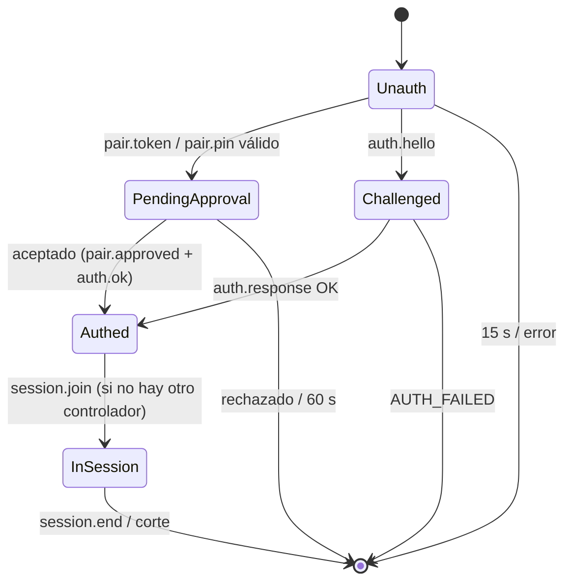

# Protocolo (v1)

Fuente de verdad: `src/shared/protocol.ts` (zod). Este documento lo describe; si difieren, manda el código y se corrige acá.

Convenciones:
- Todos los mensajes JSON son objetos con discriminante `t` (kebab/punto: `pair.token`).
- `base64url` sin padding. Tamaños: token/nonce/secret = 32 B → 43 caracteres; deviceId = 16 B → 22 caracteres.
- Coordenadas normalizadas `0 ≤ x,y ≤ 1` (se clampean igual en main).
- Todo mensaje inválido ⇒ se descarta y se responde `error{code:'BAD_MESSAGE'}` (WS) o se ignora y cuenta para el rate limit (DataChannel).
- Mensajes desconocidos se rechazan (schemas `strict`), así un cliente viejo no se cuela con campos extra.

## 1. Transporte HTTP

| Ruta | Método | Respuesta |
|---|---|---|
| `/`, `/assets/*`, `/manifest.webmanifest`, íconos | GET/HEAD | archivos de `dist-client/` (path traversal imposible: whitelist del índice de archivos al arrancar) |
| `/ca.crt` | GET | certificado público de la CA local (`application/x-x509-ca-cert`) |
| `/ws` | GET + Upgrade | WebSocket de signaling |
| todo lo demás | — | 404 / 405 |

Headers en todas las respuestas: CSP (`default-src 'self'; connect-src 'self'; img-src 'self' data: blob:; media-src 'self' blob:; style-src 'self'; script-src 'self'; frame-ancestors 'none'; base-uri 'none'; form-action 'none'`),
`X-Content-Type-Options: nosniff`, `Referrer-Policy: no-referrer`, `Cache-Control: no-store` (index) / `immutable` (assets con hash),
`Permissions-Policy` mínima.

WS upgrade: `Origin` debe ser exactamente `https://<Host>`; `maxPayload` 64 KiB; sin autenticar en 15 s ⇒ cierre `4401`.

## 2. Signaling (WSS `/ws`)

### Celular → PC

| `t` | Campos | Cuándo |
|---|---|---|
| `pair.token` | `v:1, token, deviceName (1–40)` | primer emparejamiento por QR |
| `pair.pin` | `v:1, pin (6 dígitos), deviceName` | primer emparejamiento por PIN |
| `auth.hello` | `v:1, deviceId` | reconexión |
| `auth.response` | `deviceId, hmac (base64url de 32 B)` | respuesta al challenge |
| `session.join` | `resume: boolean` | después de `auth.ok`; `resume:true` si conserva su RTCPeerConnection |
| `rtc.description` | `description: {type:'answer', sdp (≤ 32 KiB)}` | respuesta a la oferta |
| `rtc.candidate` | `candidate: {candidate, sdpMid, sdpMLineIndex, usernameFragment} \| null` | trickle ICE |
| `rtc.restart` | — | el celular detectó `disconnected/failed` y pide ICE restart |
| `session.end` | — | el usuario cortó desde el celular |

### PC → celular

| `t` | Campos | Notas |
|---|---|---|
| `pair.pending` | — | esperando aprobación en la PC |
| `pair.approved` | `deviceId, deviceSecret` | **única** vez que viaja el secreto; el celular lo guarda como CryptoKey no exportable (ADR-0009) |
| `auth.challenge` | `nonce` | un uso, vence a 30 s |
| `auth.ok` | `deviceId, hostName` | autenticado |
| `rtc.description` | `description: {type:'offer', sdp}` | la PC es siempre la ofertante (también en ICE restart) |
| `rtc.candidate` | ídem celular | |
| `session.ended` | `reason: 'USER' \| 'HOTKEY' \| 'REVOKED' \| 'REPLACED' \| 'TIMEOUT' \| 'ERROR'` | |
| `error` | `code, message, retryAfterMs?` | ver códigos |

### Códigos de error

| code | Significado | Cierra WS |
|---|---|---|
| `BAD_MESSAGE` | no pasa el schema | tras 3 |
| `TOKEN_INVALID` | token inexistente, usado o vencido | sí |
| `PIN_INVALID` | PIN incorrecto o vencido | sí |
| `PIN_LOCKED` | 5 fallos desde esta IP; `retryAfterMs` | sí |
| `REJECTED` | el usuario rechazó o venció el diálogo | sí |
| `APPROVAL_BUSY` | ya hay otro diálogo de aprobación abierto | sí |
| `AUTH_FAILED` | HMAC inválido, deviceId desconocido o nonce vencido (indistinguibles a propósito) | sí |
| `BUSY` | otro dispositivo controla la PC | sí |
| `RATE_LIMITED` | demasiados mensajes | sí |
| `INTERNAL` | error inesperado (sin detalles) | sí |

`deviceId` revocado responde `AUTH_FAILED` (no revela si existió) y el cliente borra sus credenciales.

### Máquina de estados de la conexión WS (server)

## 3. DataChannels

Creados por la PC con `negotiated: true` e ids fijos, así el celular los crea igual y no depende de `ondatachannel`.

| Canal | id | Opciones | Dirección |
|---|---|---|---|
| `input-fast` | 0 | `ordered:false, maxRetransmits:0` | celular→PC `pointer.move`; PC→celular `cursor.pos` |
| `control` | 1 | ordenado, confiable | ambos |
| `file` | 2 | ordenado, confiable | ambos |

### `input-fast`

| `t` | Campos | Notas |
|---|---|---|
| `pointer.move` | `seq (uint32), x, y` | absoluto normalizado; la PC descarta `seq` ≤ último aplicado (canal desordenado) |
| `cursor.pos` (PC→) | `x, y, visible` | cursor de la PC normalizado al display activo, ≤ 30 Hz, solo si cambió |

En modo trackpad el celular mantiene un cursor virtual (con aceleración) y manda posiciones absolutas; se resincroniza con
`cursor.pos` cuando no hay un gesto en curso. Así todo el input es absoluto y cada clic lleva su coordenada.

### `control` (celular → PC)

| `t` | Campos |
|---|---|
| `heartbeat` | `ts` (cada 1 s) |
| `pointer.button` | `button: left\|right\|middle, action: down\|up\|click, x, y` |
| `scroll` | `dx, dy` enteros en unidades WHEEL_DELTA (±1200 por mensaje) |
| `key` | `key: KeyName, action: down\|up\|tap` |
| `combo` | `keys: KeyName[1..4]` (se aprietan en orden y se sueltan al revés; Ctrl+Alt+Supr rechazado por schema) |
| `text` | `text` (1–1000 caracteres, sin controles salvo `\n`/`\t`) |
| `input.reset` | — suelta todo (el celular perdió el foco/gesto) |
| `clipboard.push` | `text` (≤ 256 KiB) |
| `clipboard.pull` | — |
| `display.select` | `displayId` |
| `quality.set` | `preset: sharp\|smooth\|saver` |
| `session.end` | — |

### `control` (PC → celular)

| `t` | Campos |
|---|---|
| `state` | `displays: DisplayInfo[], activeDisplayId, preset, audio` (al conectar y ante cambios) |
| `clipboard.data` | `text` |
| `notice` | `level: info\|warn, code` (ej. `INPUT_BLOCKED_ELEVATED`) |

`KeyName` = `a`–`z`, `0`–`9`, `f1`–`f12`, `escape, tab, enter, backspace, delete, insert, space, up, down, left, right, home, end, pageup, pagedown, ctrl, alt, shift, meta, capslock, printscreen`.

### `file` (ambos sentidos, una transferencia activa por sentido)

Mensajes texto (JSON) + binarios (`ArrayBuffer` de ≤ 16 KiB) que pertenecen a la transferencia activa de ese sentido.

| `t` | Campos | Notas |
|---|---|---|
| `file.offer` | `id, name (≤ 255), size, mime` | celular→PC ≤ 4 GiB; PC→celular ≤ 512 MiB (va a memoria como Blob) |
| *binario* | chunk | backpressure: `bufferedAmountLowThreshold` = 1 MiB, se pausa con > 4 MiB en buffer |
| `file.ack` | `id, received` | el receptor confirma cada 1 MiB; el emisor no supera 8 MiB sin confirmar |
| `file.end` | `id` | el emisor terminó |
| `file.done` | `id` | el receptor guardó (PC: en `Descargas/Kilorito Remote`) |
| `file.cancel` | `id, reason?` | cualquiera; el receptor borra el parcial |
| `file.error` | `id, code` | `TOO_LARGE`, `DISK`, `SIZE_MISMATCH` |

## 4. IPC (Electron)

### Main ⇄ renderer host (`preload/host.ts` → `window.krHost`)

| Canal | Sentido | Payload |
|---|---|---|
| `host:command` | main→host | `session.start {displayId, preset, audio}`, `session.stop`, `display.set`, `quality.set`, `audio.set`, `file.send {id,name,size}`, `clipboard.data`, `state` |
| `host:signal` | ambos | mensajes `rtc.*` |
| `host:input` | host→main | mensajes `input-fast`/`control` ya validados (main valida de nuevo) |
| `host:event` | host→main | `peer.state`, `channel.open/close`, `stats` |
| `host:file-read` (invoke) | host→main | `{id, offset, length ≤ 256 KiB}` → `Uint8Array` |
| `host:file-write` (invoke) | host→main | `{id, chunk}` → ok/error |

### Main ⇄ renderer UI (`preload/ui.ts` → `window.kr`)

`getState()`, `onState(cb)`, `selectIp(ip)`, `setPreset(p)`, `setAudio(on)`, `revokeDevice(id)`, `endSession()`,
`setStartWithWindows(on)`, `pickAndSendFile()`, `sendFiles(paths)` (drag&drop vía `webUtils.getPathForFile`), `dismissFirstRun()`, `installCaInfo()`.
